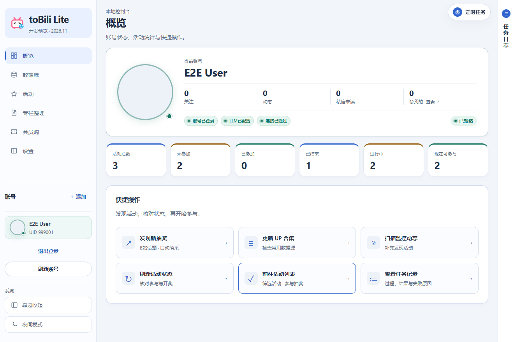
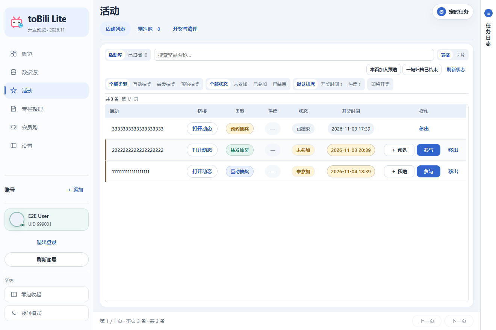
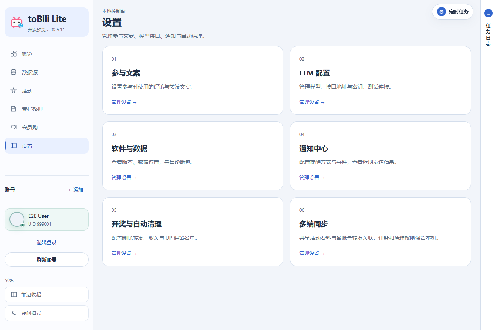

# toBili Lite

本地运行的 B 站抽奖桌面助手。集中查看活动、管理参与记录，并在开奖结果确认后清理历史转发。

**状态：开发预览 · 2026-11-03**。当前发行物用于查看界面和验证桌面运行，仍保留完整版业务基线。默认公共活动源、入口裁剪与公开接口隔离尚未完成，不将其标记为精简版正式发布。

[下载与安装](#下载与安装) · [界面预览](#界面预览) · [从源码运行](#从源码运行) · [开发与构建](#开发与构建) · [项目来源](#项目来源)

## 界面预览



<details>
<summary>活动管理与设置</summary>




</details>

截图来自本仓库构建的前端，使用隔离的模拟账号和活动数据，在 Windows Edge 中采集；不包含个人账号信息，也不是 macOS 实机截图。

## 功能与边界

| 能力 | 当前状态 |
| --- | --- |
| 活动列表、参与记录、预选池 | 开发预览可用 |
| 定时任务、参与文案、LLM 设置 | 开发预览可用，需要自行配置 |
| 消息核查、开奖确认、自动清理 | 已合入批次清理优化；需满足核查条件 |
| Windows 桌面包 | 已提供可运行的独立预览包 |
| macOS | 提供构建入口，需在 Mac 上生成原生应用 |
| 精简入口、默认公共活动源 | 待完成；当前仍可能看到完整版入口 |
| 公共接口限流与账号数据隔离审查 | 待完成，未将服务端作为正式公开发行物 |

清理按开奖时间从旧到新，每轮最多删除 20 条转发、取关 20 位 UP；消息核查结果在同轮内复用 5 分钟。确认未中奖后仍有 24 小时等待期，待确认消息、保留标记和既有关注不会因批次优化被绕过。

## 下载与安装

本地发行物放在 [`发行包/`](发行包/)，不再是空目录。上传 GitHub 时请将这些文件作为 Release 附件，构建产物不提交到源码仓库。

| 文件 | 用途 |
| --- | --- |
| `toBili-Lite-preview-20261103-Windows-x64.zip` | Windows 预览程序，解压后运行 `toBili.exe` |
| `toBili-Lite-preview-20261103-Source.zip` | 与本次预览对应的干净源码，含已编译前端 |
| `SHA256SUMS.txt` | 下载完整性校验 |

**Windows**：需要 Windows 10/11 x64 和 Microsoft Edge WebView2 Runtime。整个目录一起解压，不能只移动 EXE。没有配置活动源或远端不可用时，程序界面仍可打开，但不能保证获取新活动。

**macOS**：源码 ZIP 不是 `.app` 安装包。在 Mac 安装 Python 3.12+，解压源码后运行 `bash scripts/build-macos.command`。成功后使用 `dist/` 下与本机架构匹配的 DMG 或 ZIP。此版本未完成 Mac 实机验证，构建采用本地签名，未提供 Apple Developer ID 公证。

### 首次使用

1. 启动后自行扫码登录 B 站。发行包不附带账号、Cookie、密钥或活动数据库。
2. 按需要配置活动来源、参与文案和 LLM；没有可用模型时，相应识别功能不可用。
3. 先查看活动详情，再选择单条参与或预选池。定时任务只在应用运行时执行。
4. 自动清理默认关闭。启用前核对消息、历史转发关联及 UP 保留名单。

### 数据与升级

- Windows 预览版：程序旁的 `user-data/`。
- macOS 预览版：`~/Library/Application Support/toBili-Lite-Preview/`。
- 自定义位置：设置环境变量 `BINGGO_HOME`。显式指定后以该路径为准。

预览版默认数据目录与完整版分开。升级前退出程序并备份自己的数据目录；替换程序时保留该目录。不要将个人数据提交到 GitHub 或打入发行包。

## 从源码运行

需要 Python 3.12+。源码包已包含编译后的前端，首次启动不要求 Node.js。

```sh
python -m venv .venv
# Windows PowerShell
.venv\Scripts\python.exe -m pip install -r requirements-desktop.txt
.venv\Scripts\python.exe desktop.py
```

macOS：

```sh
python3 -m venv .venv
.venv/bin/python -m pip install -r requirements-desktop.txt
.venv/bin/python desktop.py
```

## 开发与构建

修改界面需要 Node.js 20+：

```sh
cd upstream/web/frontend
npm ci
npm run build
```

从仓库根目录构建桌面包：

```powershell
# Windows：安装依赖、编译界面、打包独立程序
powershell -ExecutionPolicy Bypass -File scripts/build-windows.ps1
```

```sh
# macOS：使用已编译前端；加 --rebuild-frontend 可重新编译
bash scripts/build-macos.command
```

测试与源码打包：

```sh
python -m pytest tests upstream/tests/test_maintenance.py upstream/tests/test_message_review.py
python scripts/package_release.py source
```

测试需要当前 Python 环境安装项目依赖和 pytest。前端测试位于 `upstream/web/frontend`，执行 `npm test`。GitHub Actions 中的 macOS 构建仅手动触发，不自动发布 Release。

## 目录结构

```text
.
├── README.md                 # 项目介绍、安装、开发与发行入口
├── NOTICE.md                 # 上游来源与许可状态
├── desktop.py                # 原生桌面入口
├── desktop_platform.py       # 平台与独立数据目录
├── desktop_instance.py       # 单实例控制
├── requirements-desktop.txt  # 桌面依赖入口
├── scripts/                  # Windows / macOS 构建、发行打包
├── tests/                    # 桌面与打包测试
├── docs/
│   ├── images/               # 当前预览版真实界面截图
│   └── UPSTREAM.md           # 保留的上游 README
├── upstream/                 # 继承并定制的业务代码
│   ├── src/                  # 数据、参与、消息与清理逻辑
│   ├── web/                  # 本地 API 与 TypeScript 前端
│   ├── tests/                # 业务回归测试
│   └── config/               # 仅配置模板
└── 发行包/                   # 本地产物，Git 忽略
```

`upstream/` 暂时保留原模块结构，避免只为目录外观改动大量导入路径。历史说明和内部评估已从交付目录移出，用户操作统一由本 README 维护。

## 反馈与贡献

报告问题请提供系统、版本、复现步骤和脱敏日志。不要上传 Cookie、二维码、API Key 或个人数据库。提交改动时说明行为变化和验证结果；界面改动附截图。公开仓库地址尚未配置，因此这里不放指向其他项目的下载、Stars 或 Issues 徽章。

## 项目来源

基于 [bilibinggo](https://github.com/luovicter-collab/bilibinggo) 定制。来源、固定基线和许可状态见 [NOTICE.md](NOTICE.md)，上游原始介绍保留在 [docs/UPSTREAM.md](docs/UPSTREAM.md)。本项目不是 B 站官方工具，也不是上游作者发布的官方安装包。
