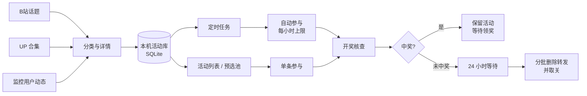

<div align="center">


# toBili

**一个窗口，管住所有号的抽奖**

自动发现活动 · 按周期自动参与 · 开奖核查后安全收尾 · 全程跑在你自己电脑上

<sub>Local-first Bilibili lottery console for Windows & macOS — multi-account, scheduled auto-join, draw verification and safe cleanup.</sub>

<br>

<a href="https://github.com/menyuhe/toBili/releases/latest"></a>
<a href="https://github.com/menyuhe/toBili/stargazers"></a>


<a href="LICENSE"></a>

<br><br>

<a href="https://github.com/menyuhe/toBili/releases/latest"><b>下载</b></a>
&nbsp;·&nbsp;
<a href="docs/guide.md"><b>使用手册</b></a>
&nbsp;·&nbsp;
<a href="#常见问题"><b>常见问题</b></a>
&nbsp;·&nbsp;
<a href="https://github.com/menyuhe/toBili/issues"><b>反馈</b></a>

</div>

> [!IMPORTANT]
> **仅供个人学习与研究使用**，非官方工具，与哔哩哔哩无隶属关系。
> 请遵守法律法规与平台规则，**不要**用于代抽牟利、黑产或任何违反平台协议的行为。
> 多账号能力面向「自己的多个账号」，请理性使用、控制频率；账号风控后果由使用者自行承担。
> 本项目不附带账号、Cookie、密钥或活动库，也不提供任何自动化代刷服务。

<div align="center">

</div>

抽奖的麻烦从来不是「点一下」，而是**找**和**守**：翻十几个 UP 的合集、刷监控名单的动态、盯着开奖时间、中奖了还要回头清掉一堆历史转发。

toBili 把这条链路收进一个本地窗口：合集和话题自动发现 → 活动库按开奖时间排好 → 定时任务到点自己跑 → 开奖核查确认没中再分批收尾。**同时挂几个号也不会串**——每个号独立的 Cookie、独立的活动状态、独立的调度计划。

| | |
|---|---|
| **多账号运营** | 一个窗口登录多个号，各自独立参与、独立排队、独立核查，互不打扰 |
| **自动发现** | 4 个 B 站话题 + 9 个内置 UP 合集 + 自定义监控名单，三路互补不漏活动 |
| **自动参与** | 5 类周期任务 + 7×24 挂机模式，带每小时上限与撞车保护 |
| **安全收尾** | 开奖核查 → 未中奖等待 24 小时 → 每轮最多删 20 条转发、取关 20 位 UP |
| **纯本地** | SQLite 存本机，服务只监听回环地址，不注册、不上云、不收集账号数据 |

## 目录

- [一眼看懂](#一眼看懂)
- [多账号运营](#多账号运营)
- [功能详解](#功能详解)
- [界面导览](#界面导览)
- [和手动刷 / 通用脚本比](#和手动刷--通用脚本比)
- [工作方式](#工作方式)
- [下载与上手](#下载与上手)
- [数据、备份与升级](#数据备份与升级)
- [常见问题](#常见问题)
- [开发与构建](#开发与构建)
- [目录结构](#目录结构)
- [许可](#许可)

## 一眼看懂

| 维度 | 说明 |
| --- | --- |
| **产品形态** | Windows 桌面应用（`toBili.exe`）；macOS 由源码构建 DMG / ZIP。界面是原生窗口，不占用浏览器 |
| **账号** | 可同时登录多个 B 站账号；Cookie、参与记录、预选池、计划、核查状态**全部按号隔离** |
| **发现通道** | B 站话题（4 个）× UP 合集（9 个内置，可增删）× 监控用户动态（自定义 MID 名单） |
| **参与类型** | 互动抽奖、转发抽奖、预约抽奖；**充电抽奖自动跳过**，避免误扣费 |
| **自动化** | 5 类周期任务 + 7×24 挂机模式，周期 5 分钟 ~ 7 天；**仅在应用运行时生效** |
| **收尾策略** | 开奖核查 → 未中奖等待 24 小时 → 分批删除历史转发并取关 |
| **数据归属** | 本地 SQLite + 本地文件，不上传云端；控制台服务仅绑定 `127.0.0.1` 并带一次性令牌 |
| **许可** | MIT，可商用、可修改、可闭源再分发 |

## 多账号运营

一个号抽奖靠运气，几个号一起抽才是常态——但绝大多数工具默认「一个 Cookie 走天下」，换个号就得重新登录、记录全乱。

toBili 从数据层就是按账号拆开的：侧栏的账号列表可以**同时挂着多个号**，随时点一下就切换视图，扫码对话框再扫一次就是「添加」，原有账号的登录状态不受影响。

<p align="center">
<br>
<sub>一个号在跑预选池（3/12），另一个号有 3 条消息待核查——各自独立</sub>
</p>

| 隔离维度 | 行为 |
| --- | --- |
| **登录凭证** | 每个号自己的 Cookie，存于本机 `config/accounts/<uid>/`；退出一个号不影响其他号 |
| **业务数据** | 参与、预约、归档、预选池、参与设置、调度计划、开奖结果、清理状态各自一份 |
| **任务队列** | 同一账号的任务串行排队；**不同账号可以并行**；所有网络请求仍统一限速 |
| **定时计划** | 每个号单独配置刷新周期、挂机开关与每小时上限，互不覆盖 |
| **消息核查** | 私信与 @ 检查按号进行，某个号有待确认消息时只暂停**该号**的清理 |
| **共享部分** | 活动资料（奖品、开奖时间）全号共用一份，避免重复抓取与重复消耗 LLM |

这带来几个实际好处：

- **号多但不乱** —— 主号跑互动抽奖，小号专跑预选池，第三个号挂着 7×24 挂机，互不抢队列。
- **一个号出问题不连坐** —— 某个号登录过期只会停掉它自己的调度，其他号照跑。
- **清理可以逐号确认** —— 中奖消息只在对应的号上出现，不会误删别的号的历史转发。
- **风控更从容** —— 每个号可以设置不同的每小时参与上限，节奏各自独立。

> 添加账号只是多一个本地 Cookie；切换到哪个号，界面上的活动统计、任务日志、消息提醒就跟着换成哪个号的。

## 功能详解

### 数据源：三路互补地「找」

- **B 站话题发现** —— 直接读 B 站话题动态（互动抽奖、抽奖专用频道、互动/转发抽奖合集），不依赖第三方数据库；首次可「补齐近 7 天」，之后增量续采。
- **UP 合集** —— 内置 9 个常用抽奖合集（含 2 个备用源），可自行添加/修改/移除；每个源最多取最新 20 条，只处理新链接。
- **监控用户动态** —— 填 MID 加入名单，按时间窗口拉这些人的转发动态，补合集漏抓；默认回溯约 10 天。

三者入库前统一分类：官方互动组件走平台开奖接口，预约卡片走预约识别，其余转发抽奖用 LLM 解析正文；充电与非抽奖活动不入库。

<p align="center">

</p>

> 日常建议点单个源的「更新此源」；「一键更新」会串行扫全部合集，请求更猛，更适合空库首次灌库。

### 活动库：按开奖时间排队

- 类型筛选（互动 / 转发 / 预约）、状态筛选（未参加 / 已参加 / 已结束）、热度排序、关键词搜索、分页浏览。
- 「即将开奖」一键收窄到 3 天内开奖的已参与活动，「刷新任务状态」只回查结果、不拉新链接。
- 未参加且已过期的活动自动隐藏（本地仍保留历史）；活动可手动「移出」到已归档，更新不会自动恢复。

### 参与：三类动作，一步到位

| 类型 | 实际动作 | 说明 |
| --- | --- | --- |
| **互动抽奖** | 点赞 → 关注 → 收藏 → 转发 → 评论 | 已完成的项自动跳过，不会把状态点反 |
| **转发抽奖** | 关注 → 转发 → 评论 | 需 LLM 先解析正文中的奖品与开奖时间 |
| **预约抽奖** | 关注 → 预约 | 与直播/预约节点联动 |
| **充电抽奖** | — | **自动跳过**，不会扣费 |

参与文案可固定，也可「随机借用」活动下已有评论，最多 233 字。

### 预选池与挂机：把「今天抽哪些」交给队列

- **预选池** —— 手动把活动加入池子（上限 200），按顺序逐条参与；可暂停单项，定时任务只跑未暂停的。
- **挂机模式** —— 开启后自动「刷新来源 → 参与活动库里所有可参与项 → 开奖核查与安全清理」，跳过已参加、已移出、不可参与项。
- **每小时上限** —— 按最近 60 分钟**尝试次数**计数（失败也计入），默认 20、可设 1~500；达到上限自动等待，重启不清零。
- **失败即停** —— 失败或人工暂停后不会自作主张继续，需要你确认后恢复。

### 定时任务：按周期自动跑

| 任务 | 默认周期 |
| --- | --- |
| B 站话题发现 | 180 分钟 |
| 一键更新活动链接 | 180 分钟 |
| 更新监控用户动态 | 180 分钟 |
| 刷新任务状态 | 180 分钟 |
| 预选池参与 | 5 分钟 |
| 挂机刷新 / 开奖清理 | 180 / 30 分钟 |

- 周期可设 **5 分钟 ~ 7 天**；计划**按账号保存**，保存不等于启动。
- 点击「启动调度」后开始计时；**关闭软件即停止**，不会在后台偷偷跑。
- **撞车保护**：已有任务在跑时延后执行；「停止调度」只停计划，**不取消**正在进行的参与。

<p align="center">

</p>

### 开奖核查与安全清理

这是 toBili 最「不敢快」的部分，因为删错东西是不可逆的。

- **先核查消息** —— 每次开奖核验都会检查私信与 @；首次纳入现有未读，之后按消息标识与游标检查新增，手机已读也不影响识别。
- **待确认就暂停** —— 有可疑消息时暂停该账号清理，你可以标记「与领奖无关」或「已中奖」；没有消息**不等于**未中奖。
- **等待期** —— 确认未中奖后仍有 **24 小时**等待期，避免手快。
- **分批执行** —— 每轮最多删除 **20 条转发**、取关 **20 位 UP**，按开奖时间从旧到新处理。
- **硬约束不可绕过** —— 保留名单、既有关注、待确认消息不会因批次优化被跳过；核查结果在同一轮内复用 5 分钟。
- **默认关闭** —— 清理功能默认不开，需要你主动启用并核对设置。

### 其余贴心细节

- **LLM 解析** —— 兼容 OpenAI 接口（推荐 DeepSeek），只用于解析转发抽奖正文；互动 / 预约不消耗 token。接口地址为必填项，保存与测试前都会校验。
- **通知** —— 桌面音频 + 钉钉机器人（支持加签）双通道，覆盖中奖、@ 未读增加、登录失效、任务失败、清理汇总五类事件；推送失败自动进发件箱重试。
- **实时日志** —— SSE 推送任务日志，断线自动回退轮询；顶部进度条显示阶段与百分比。
- **诊断包** —— 一键导出脱敏诊断信息（不含 Cookie 与 API Key），排查问题不用截图乱猜。
- **夜间模式** —— 亮/暗主题本地记忆；侧栏可收起腾地方。
- **单实例保护** —— 重复启动不会开出第二个窗口；有任务在跑时退出会拦一下。

## 界面导览

<table>
<tr>
<td width="50%"><br><sub><b>活动库</b>：类型 / 状态 / 热度筛选，即将开奖，行内参与</sub></td>
<td width="50%"><br><sub><b>定时任务</b>：周期计划、挂机模式、每小时上限</sub></td>
</tr>
<tr>
<td width="50%"><br><sub><b>数据源</b>：话题、合集与监控名单三路发现</sub></td>
<td width="50%"><br><sub><b>设置</b>：参与文案、通知、清理策略与诊断</sub></td>
</tr>
</table>

<p align="center">
<br>
<sub><b>LLM 配置</b>：兼容 OpenAI 接口，保存后先「测试连接」再使用</sub>
</p>

<sub>截图来自本仓库构建的前端，运行在隔离的模拟账号与模拟活动数据上，不含任何个人账号信息；界面在 Windows Edge 中采集，非 macOS 实机截图。</sub>

## 和手动刷 / 通用脚本比

| | 手动刷动态、翻合集 | 通用抽奖脚本 | **toBili** |
| --- | --- | --- | --- |
| **发现活动** | 全靠自己翻 | 通常只跑固定合集 | 话题 + 合集 + 监控名单三路互补 |
| **参与方式** | 一条条手点 | 批量跑，无界面 | 行内单条、预选池排队、定时/挂机自动 |
| **多账号** | 换号重登，记录全乱 | 多数只支持单 Cookie | **按号隔离 Cookie、数据、计划与核查** |
| **开奖之后** | 忘了删，转发越堆越多 | 常需手工清理 | 核查消息 → 等待期 → 分批删除并取关 |
| **风险控制** | 全凭手感 | 节奏固定易触发风控 | 每小时上限、任务串行、撞车延后 |
| **数据归属** | 在 B 站侧 | 各异，可能需要上传 | 本机 SQLite，不上云、不注册 |
| **可审可信** | — | 视项目而定 | MIT 开源，可自行编译核对 |

## 工作方式



- 所有重任务走统一 Job 队列，同一时刻通常只跑一个；同一账号串行，不同账号可并行。
- 转发抽奖入库时调用 LLM 解析奖品与开奖时间，互动/预约不经过模型。
- 控制台服务只监听回环地址，并且要求桌面会话令牌，浏览器直接打开会被拒绝。

## 下载与上手

| 平台 | 方式 |
| --- | --- |
| **Windows 10/11 x64** | 从 [Releases](https://github.com/menyuhe/toBili/releases/latest) 下载 `toBili-*-Windows-x64.zip`，解压后运行 `toBili.exe`；同页附 `SHA256SUMS.txt` 校验 |
| **macOS** | 源码构建：`bash scripts/build-macos.command`，产物在 `dist/`（Apple Silicon / Intel 均可用本机构建） |
| **源码运行** | Python 3.12+，仓库自带编译好的前端，首次启动不需要 Node.js |

### 60 秒跑起来

1. 解压后运行 `toBili.exe`（需要 [WebView2 运行时](https://developer.microsoft.com/microsoft-edge/webview2/)，Win11 通常已内置）。
2. 侧栏点 **扫码登录**，用 B 站 App 扫码；想挂多个号就再点「＋ 添加」扫一次。
3. 进 **数据源**，对常用的合集点 **更新此源**，或点 **更新话题** 拉最近的公开抽奖。
4. 进 **活动**，筛「未参加」，点行内 **参与**；也可以加入 **预选池** 让它排队。
5. 想挂机：右上角 **定时任务** → 勾选需要的周期 → **保存当前账号计划** → **启动调度**。

> [!NOTE]
> Windows 版本未做商业代码签名，首次运行可能出现 SmartScreen 提示，选择「更多信息 → 仍要运行」即可；请只从本仓库 Releases 下载，不要运行来路不明的二次打包版本。

### 从源码运行

需要 **Python 3.12+**：

```powershell
# Windows PowerShell
python -m venv .venv
.venv\Scripts\python.exe -m pip install -r requirements-desktop.txt
.venv\Scripts\python.exe desktop.py
```

```sh
# macOS / Linux
python3 -m venv .venv
.venv/bin/python -m pip install -r requirements-desktop.txt
.venv/bin/python desktop.py
```

首次启动会创建独立数据目录，程序不会读取你浏览器里的 B 站登录状态——账号必须自己扫码。

## 数据、备份与升级

| 平台 | 默认数据目录 |
| --- | --- |
| Windows | 程序旁的 `user-data/` |
| macOS | `~/Library/Application Support/toBili/` |
| 自定义 | 设置环境变量 `BINGGO_HOME`（显式指定后以该路径为准） |

- 活动库、参与记录、账号 Cookie、日志、诊断信息都在这个目录里；想换机器，把整个目录一起拷走。
- 升级请先退出程序并备份数据目录，替换程序文件时保留该目录。
- **不要**把数据目录提交到 GitHub，也不要打进发行包。

## 常见问题

**安全吗？会上传我的 Cookie 吗？**
不上传。Cookie 存在本机 `config/accounts/<uid>/`，活动库是本机 SQLite，程序没有作者服务器可以连；唯一的对外请求是 B 站接口和你自己配置的 LLM 接口/通知 Webhook。

**多开几个号会被封吗？**
toBili 只是把你本来会手点的操作按节奏执行，并提供每小时上限与任务串行，但**无法保证账号安全**。请控制频率、避免大量并发，别把工具当刷量机器用。

**一定要配 LLM 吗？**
只有「转发抽奖」需要——要从正文里解析奖品和开奖时间。互动、预约抽奖不消耗模型，没配 LLM 也能正常参与。

**为什么定时任务没跑？**
三个最常见原因：调度没点「启动调度」、软件被关掉了（计划只在应用运行时生效）、或者当前选中的账号没有可用登录。计划是**按账号**保存的，换号后要确认看到的计划是不是这个号的。

**为什么建议少用「一键更新」？**
它会串行扫全部合集，请求量和耗时都明显更高，更容易触发风控。日常用「更新此源」单点更新更稳。

**清理会不会误删我刚转发的？**
清理按开奖时间从旧到新走，只处理已确认未中奖且过了 24 小时等待期的活动；每轮上限 20 条；有可疑消息会直接暂停该账号的清理。保留名单里的活动永远不动。

**换电脑 / 重装系统怎么迁移？**
把整个数据目录拷到新机器的同一位置（或设置 `BINGGO_HOME` 指向它）即可，账号、活动、参与记录都在里面。

**支持 Intel Mac / Linux 吗？**
macOS 可在 Intel 机器上用源码构建；Linux 未提供发行包，可用源码运行，但未做系统性验证。

**能用手机远程打开界面吗？**
不能，也不建议。控制台只监听 `127.0.0.1`，并校验桌面会话令牌；把本地服务暴露到公网会带来严重安全风险。

## 开发与构建

### 前端

修改界面需要 **Node.js 20+**：

```sh
cd upstream/web/frontend
npm ci
npm run build     # 输出到 upstream/web/static/dist/
npm test          # 前端测试
```

仓库内置的 `upstream/web/static/dist/` 是随源码分发的构建产物，clone 后即可直接运行；重新构建会覆盖该目录。

### 桌面打包

```powershell
# Windows：安装依赖、编译界面、打包独立程序
powershell -ExecutionPolicy Bypass -File scripts/build-windows.ps1
```

```sh
# macOS：使用已编译前端；加 --rebuild-frontend 可重新编译
bash scripts/build-macos.command
```

### 测试与发行

```sh
python -m pytest upstream/tests            # 后端回归
python scripts/package_release.py source   # 生成源码发行包
python scripts/package_release.py windows  # 生成 Windows 发行包
```

GitHub Actions 中的 macOS 构建仅手动触发，不自动发布 Release。

## 目录结构

<details>
<summary>展开查看</summary>

```text
.
├── desktop.py                # 原生桌面入口（本机回环服务 + 令牌守卫）
├── desktop_platform.py       # 平台差异与独立数据目录
├── desktop_instance.py       # 单实例控制
├── scripts/                  # Windows / macOS 构建与发行打包
├── tests/                    # 桌面与打包测试
├── docs/
│   ├── guide.md              # 使用手册
│   └── images/               # logo 与界面截图
└── upstream/                 # 业务代码
    ├── src/                  # 发现、参与、核查、清理与账号状态
    ├── web/                  # 本地 API 与前端
    │   ├── frontend/         # 前端源码（Vite + TypeScript）
    │   └── static/dist/      # 已编译前端，随源码分发
    ├── tests/                # 业务回归测试
    ├── scripts/              # 采集、维护与修复脚本
    └── docs/                 # 设计与实现说明
```

</details>

## 许可

[MIT License](LICENSE) © 2026 menyuhe

- **商用** —— 用于商业产品、内部系统或对外服务，无需付费，也无需告知作者
- **修改** —— 改代码、改界面、改功能，随意
- **分发与二创** —— 复制、合并、发布、再授权，包括闭源分发

唯一要求：在副本或实质性部分中保留版权声明与许可声明。软件按现状提供，不附带任何担保。

## 反馈与贡献

- 报问题请附：系统版本、程序版本、复现步骤、脱敏日志或诊断包
- 提 PR 请说明行为变化与验证方式；界面改动请附截图
- **不要上传** Cookie、二维码、API Key 或个人数据目录

---

<div align="center">

**如果 toBili 帮你省下了翻合集和盯开奖的时间，点个 Star 就是最好的支持。**

<a href="https://github.com/menyuhe/toBili/stargazers"></a>

<sub>MIT · 可自由使用、修改、商用与再分发，不附带任何担保。</sub>

</div>
