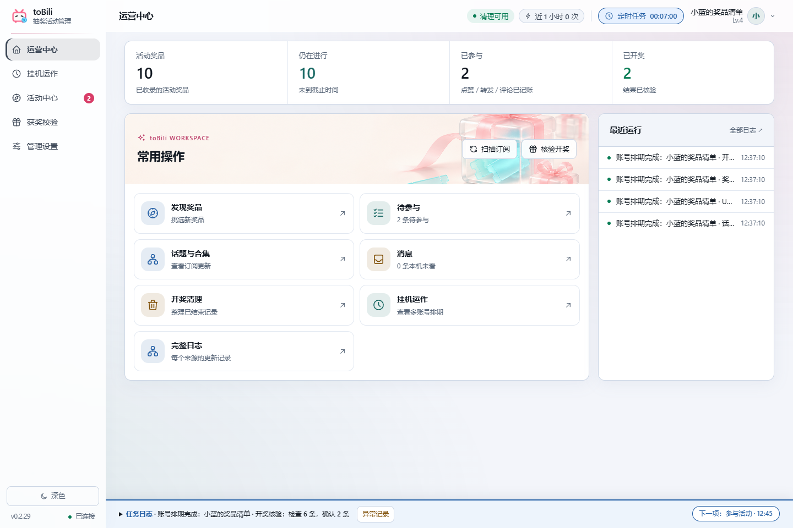
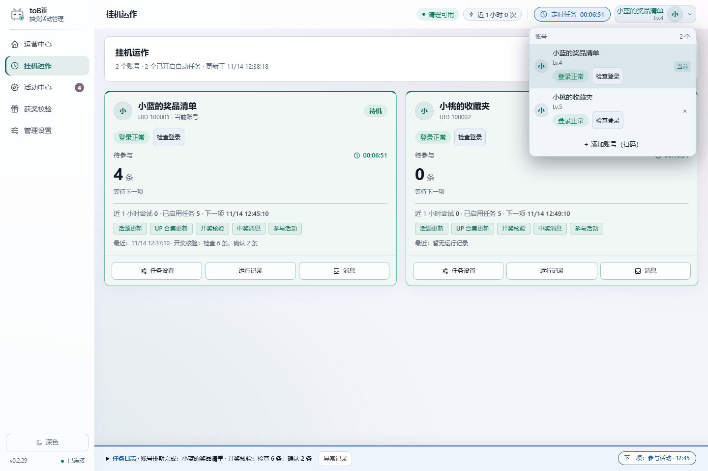
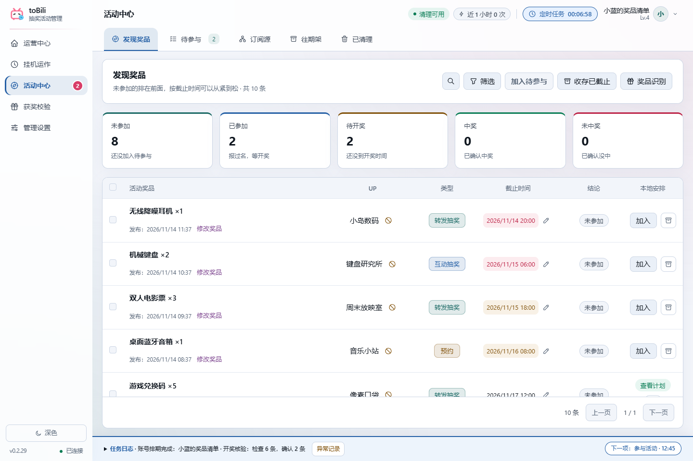
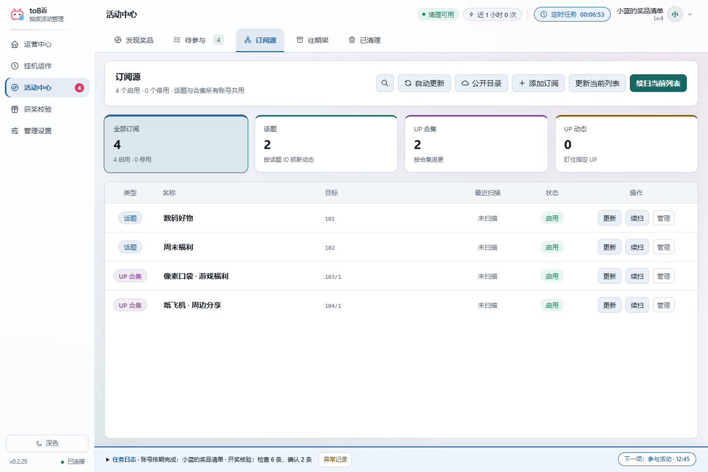
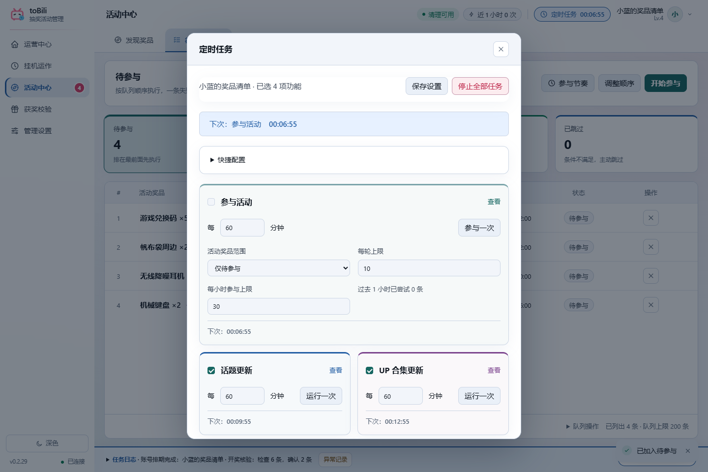
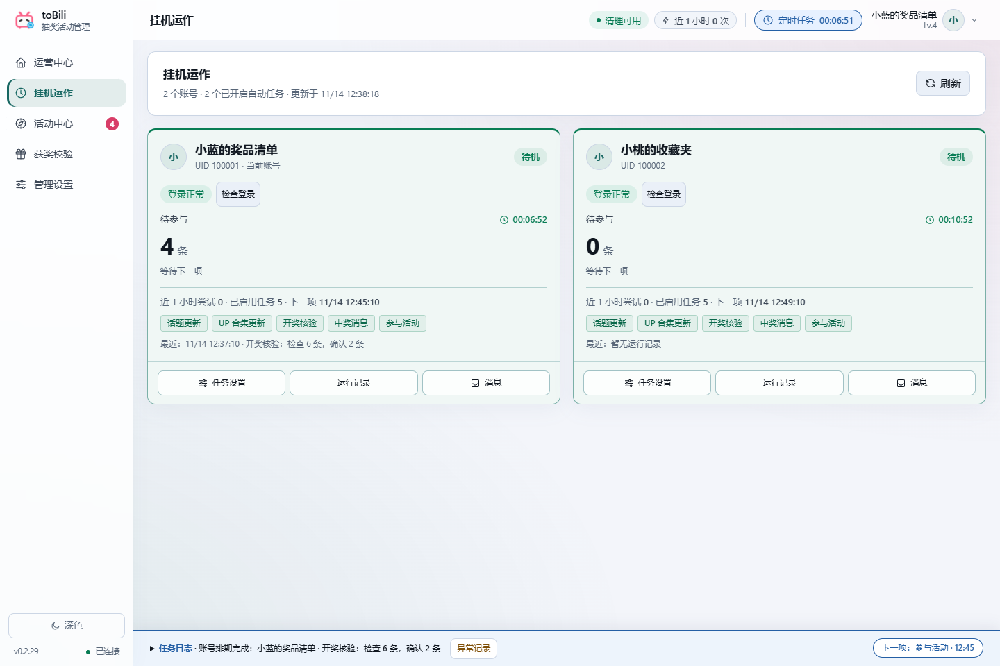
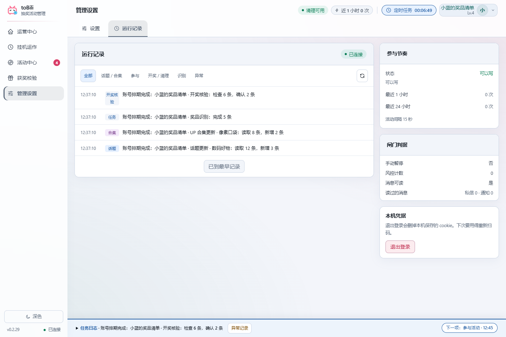
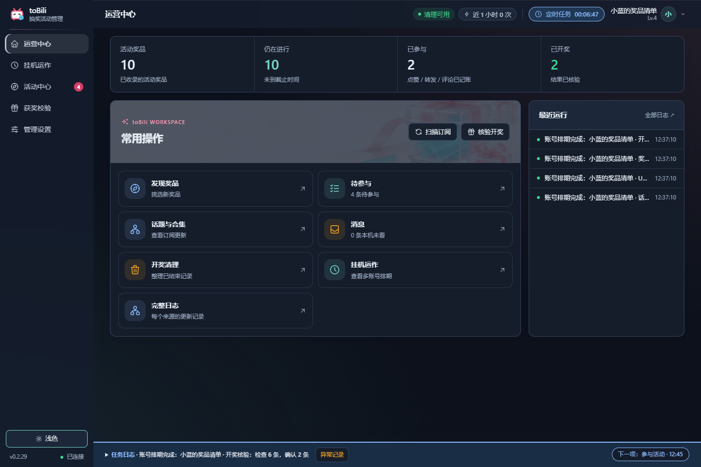

<div align="center">
  
  <h1>toBili</h1>
  <p><strong>把散落在动态里的抽奖，整理成看得清、跟得上的奖品清单。</strong></p>
  <p>B 站抽奖活动管理工具 · 本机多账号 · Windows / macOS</p>
  <p>
    <a href="https://github.com/menyuhe/toBili/releases/latest">下载桌面版</a> ·
    <a href="docs/public/GUIDE.md">使用指南</a> ·
    <a href="docs/public/MAC.md">Mac 安装</a> ·
    <a href="docs/public/CHANGELOG.md">更新记录</a> ·
    <a href="https://github.com/menyuhe/toBili/issues">反馈问题</a>
  </p>
  
  
  
</div>

<br>



刷到活动、记下截止时间、切换账号、回头找开奖公告——事情不复杂，分散在不同页面里却很容易漏。toBili 把这些步骤放到同一个本机工作台：**先挑奖品，再安排参与，最后核验和收尾。**

话题和 UP 合集由本机账号共用；参与历史、消息标记与任务计划各自保存。你可以只用它整理活动，也可以为自己的账号开启定时任务。

## 下载与开始

| Windows | Mac · Apple 芯片 | Mac · Intel |
|:---:|:---:|:---:|
| [下载 EXE](https://github.com/menyuhe/toBili/releases/latest/download/toBili.exe) | [下载 arm64 ZIP](https://github.com/menyuhe/toBili/releases/latest/download/toBili-macOS-arm64.zip) | [下载 x86_64 ZIP](https://github.com/menyuhe/toBili/releases/latest/download/toBili-macOS-x86_64.zip) |

[全部安装包、源码与 SHA256 校验值](https://github.com/menyuhe/toBili/releases/latest)

1. **启动并登录。** Windows 将 EXE 放进独立文件夹；Mac 解压后放进「应用程序」。扫码添加自己的账号，新账号默认不开启自动任务。
2. **找到感兴趣的奖品。** 在「活动中心 → 订阅源」添加话题、UP 合集，或读取[公开奖品目录](https://tobili.4wdo.cn/public/)。筛选活动、校对资料，再加入待参与。
3. **按自己的节奏安排。** 顶栏「定时任务」设置当前账号的功能、周期与范围；到「挂机运作」查看各账号的进度和下一次执行时间。

Windows 需要 WebView2 Runtime。任务只在程序运行、电脑联网时执行；持续挂机可使用 `toBili.exe --tray`。详细安装、升级和数据位置见[使用指南](docs/public/GUIDE.md)。

## 从一份清单，到一轮完整流程


*截图与 GIF 来自 0.2.29 的真实界面，使用虚构账号和奖品；演示没有登录真实账号，也没有向 B 站发出参与操作。*

| 想解决的问题 | toBili 怎么做 |
|:---:|:---:|
| 奖品信息埋在长篇动态里 | 简明奖品名、数量与截止时间放在列表中，点击标题查看原动态 |
| 互动抽奖和预约抽奖容易混淆 | 优先读取官方组件中的奖品、时间、状态和条件，模型按需补充正文与图片 |
| 账号多，不清楚哪个正在跑 | 每个账号单独显示当前事项、下一事项、倒计时和登录状态 |
| 不知道订阅到底更新了什么 | 话题、合集、识别、参与和核验日志分别记录具体进度 |
| 有活动失败，怕挡住后面的 | 单条业务问题保留原因；能继续的任务接着处理，未知发送结果先核查 |
| 到了开奖时间，还要回头翻动态 | 开奖核验结合官方组件、公告与消息；可人工校对结论 |
| 历史转发越来越多 | 先查看清理清单与核验依据，再执行删除；到期不会直接当成未中奖 |

## 0.2.29：账号状态更清楚，任务接续看得见

**“暂时读不到”与“需要重新登录”，现在分开显示。** 账号菜单和挂机运作页提供登录检查；网络超时、平台限流或钥匙串未授权时，显示暂无法确认，只有明确登录失效才提示重新扫码。



- **状态按账号独立检查。** 一个账号的读取不拖住另一个；重新扫码后，旧检查不会覆盖新登录结果。
- **页面不再一直等。** 读取接口超时会显示重试提示，后台任务不会因此被页面停止，也不会自动重复提交写入请求。
- **接续原来的计划。** 修正恢复场景的重试时间计算，保留原周期；明确登录失效时保留任务设置，重新登录后继续调度。
- **旧错误有时间，新结果有位置。** 最新成功结果替换当前错误，历史记录仍保留，方便追溯。

[查看完整更新记录](docs/public/CHANGELOG.md)

<details>
<summary><strong>展开界面图集：奖品、订阅、排期、账号与深色主题</strong></summary>

### 奖品列表：先看想要什么，再决定参加哪个



### 订阅源：话题与合集分开管理，本机账号共用



### 定时任务：按账号设置周期、数量与参与范围



### 挂机运作：当前状态、登录检查和下一事项



### 运行记录：追到具体来源和具体步骤



### 深色主题：沿用同样的布局，记住你的选择



</details>

## 用之前，几个常见问题

**必须配置大模型吗？** 不是。官方互动与预约组件优先提供结构化信息；你也可以人工修改奖品和时间。需要识别正文、图片或生成参与文案时，再配置自己的兼容模型接口。模型识别不是对奖品或开奖时间的保证。

**已经参与过的，会不会再发一次？** 程序会查参与账本与平台状态；已成功或结果未知的转发、评论不会盲目重发。历史核查没完成的条目会显示待处理，不应把“整轮运行结束”理解成“每条活动全部完成”。

**为什么开着任务，却没有新增参与？** 可能没有符合条件的活动、达到每小时上限、正在冷却，或账号需要重新登录。先看「挂机运作」和最新参与日志，不必反复点击参与一次。具体状态与处理方式见[登录与任务排查](docs/public/GUIDE.md#登录与任务排查)。

**更新后需要重新建账号吗？** 同一系列版本升级保留原数据：Windows 退出后替换原文件夹里的 EXE，保留 `data/`；Mac 覆盖原应用，保留 Application Support 中的数据。跨电脑复制凭据可能需要重新扫码。从历史旧实现迁移请先看[迁移说明](docs/public/MIGRATION.md)。

## 数据与运行方式

- **账号与历史留在本机。** Windows 用当前系统用户的 DPAPI 加密凭据，Mac 用登录钥匙串保管加密密钥。
- **公开目录匿名只读。** 获取奖品、原动态、公开 UP 信息和修订，不上传账号、参与记录或私信；目录不可用时仍可使用自己的订阅源。
- **模型服务由你选择。** 配置模型后，待识别正文、图片或参与文案上下文会发给对应服务。模型密钥保存在本机保险库。
- **时间可以校对。** 明确开奖时间优先；估算日期不是官方确认时间。手动修订会保留，详细规则见[时间与资料校对](docs/public/GUIDE.md#时间与资料校对)。
- **执行按本机账号串行。** 本机锁不协调另一台电脑；不要让多台设备同时为同一账号执行参与任务。接口变化、网络与平台限制仍可能影响运行。

## 从源码运行

需要 Python 3.12+、uv、Node.js 20+。

```bash
git clone https://github.com/menyuhe/toBili.git
cd toBili
uv sync --locked
cd ui
npm ci
npm run build
cd ..
uv run tobili serve --port 8848
```

浏览器打开 `http://127.0.0.1:8848`。Windows 与 macOS 共用界面和业务代码。

[构建与验证](docs/public/GUIDE.md#验证与参与开发) · [Mac 原生构建](docs/public/MAC.md) · [项目结构](PROJECT.md) · [反馈与协作](https://github.com/menyuhe/toBili/issues)

## 项目说明

当前实现使用 **AGPL-3.0-or-later**，见 [LICENSE](LICENSE)。历史版本与许可证保留在原标签中。toBili 是非官方工具，与哔哩哔哩无隶属关系。
