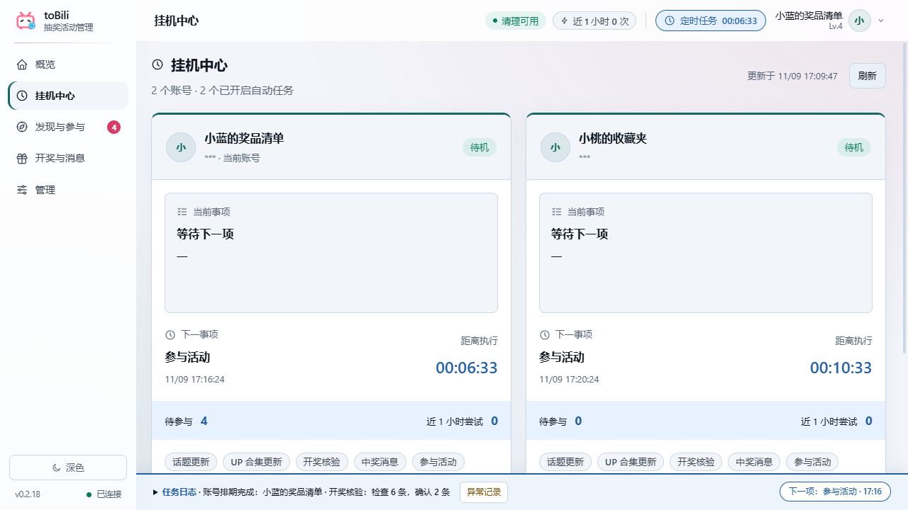

# toBili for Mac

[返回首页](../../README.md) · [下载页面](https://github.com/menyuhe/toBili/releases) · [使用指南](GUIDE.md)

Mac 和 Windows 使用同一套界面与业务代码：发现奖品、多账号挂机、定时参与、开奖消息、清理与公开目录读取。直接在本仓库维护，无需另找一个 Mac 项目。

## 安装

系统要求：macOS 15 或以上。

| 你的 Mac | 对应安装包 |
|:---:|:---:|
| Apple 芯片（M 系列） | `toBili-macOS-arm64.zip` |
| Intel 芯片 | `toBili-macOS-x86_64.zip` |

从下载页面选择对应安装包，解压并把 `toBili.app` 拖到「应用程序」，双击打开。当前构建仅使用本地签名，尚未通过 Apple 公证；首次被系统拦截时，在「系统设置 → 隐私与安全性」找到本次打开记录，选择「仍要打开」。不要关闭整个系统的安全检查。

## 日常使用



界面示意使用虚构数据。话题与 UP 合集供本机所有账号共用，参与记录与排期按账号分别管理；顶栏可随时打开定时任务，侧栏「挂机中心」查看倒计时。浅深主题会记住上次选择。

## 数据与账号

- 数据：`~/Library/Application Support/toBili`。在 Finder 按 `⌘⇧G` 粘贴路径即可进入。
- 账号凭据加密后保存在此目录；加密密钥存入当前用户的登录钥匙串。钥匙串不可访问时，程序会报错，不会改为明文保存。
- 复制 Windows 数据库不会复制 Windows 的解密能力。迁移前保留完整备份，Mac 上重新扫码登录。
- 「在 B 站打开」使用该账号的独立临时 WebKit 窗口，不改变 Safari 的登录账号，也不与另一账号窗口混用 Cookie。
- 系统设置支持登录后启动。任务需要当前用户已登录、Mac 联网且未休眠；关机或睡眠期间不能运行。

## 升级与卸载

退出应用后备份整个数据目录，再替换「应用程序」中的应用。删除应用不会自动删除数据。需要完全移除时，先关闭登录启动，再移除应用和自己的数据目录。

## 原生构建

必须在 Mac 上构建对应芯片架构的应用，不支持在 Windows 上交叉打包。

```bash
uv sync --locked
cd ui
npm ci
npm run typecheck
npm run build
cd ..
uv run pytest -q
uv run python tools/build_macos.py
PYTHONPATH=core/src uv run python tools/smoke_macos.py
```

产物位于 `dist/`。仓库的 macOS 工作流分别在 Apple 芯片与 Intel 构建机执行测试、签名验证、钥匙串加密、Cookie 隔离和打包应用启动检查。检查只使用模拟数据，不操作真实 B 站账号。
